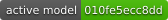
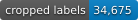

# Anomaly Vision Model

[](https://github.com/ufo-files/anomaly-vision-model/releases/tag/model-2e4cfc2cb67f40cace0c1da037dd7d728477259e4bc83273a87c266656be8386)
[](https://github.com/ufo-files/anomaly-vision-model/releases/latest)
[](https://github.com/ufo-files/anomaly-vision-model/releases/latest)

Visual anomaly classification for [UFO Files Field Station](https://github.com/ufo-files/field-station). The current model classifies detected camera-image crops as **Anomalous** or **Not Anomalous**, using examples reviewed by the station operator.

Download the current model from [the latest release](https://github.com/ufo-files/anomaly-vision-model/releases/latest). New deployed models are published as versioned GitHub Releases; the date of the latest commit on `main` is not the date of the latest model.

## Download a model

With the GitHub CLI installed:

```bash
mkdir anomaly-vision-model-release
cd anomaly-vision-model-release
gh release download --repo ufo-files/anomaly-vision-model   --pattern model.tar.gz --pattern model-card.json --pattern SHA256SUMS
shasum -a 256 -c SHA256SUMS
tar -xzf model.tar.gz
```

Model releases include:

- `model.tar.gz`: the Core ML classifier package, trained weights, matching classification policy, evaluation summary, model card, and internal checksums.
- `model-card.json`: the model version, previous version, deployment time, classes, and validation limitations.
- `SHA256SUMS`: checksums for the downloadable model archive and model card.

The archive retains the filenames `candidate.mlpackage`, `candidate-weights.pt`, and `candidate-policy.json` used during training. These names do not describe deployment status: published bundles represent deployed models.

Use the Core ML package together with its matching policy in Field Station's native recognition pipeline. The policy defines preprocessing and classification behavior. The legacy `inference.py` in this repository does not load these Core ML releases. Training images, individual review records, and full recordings are not included in current model bundles.

The active-model badge mirrors the station header’s 12-character hash and links to that version’s release. It syncs from the station’s confirmed runtime status; if the station is unreachable, it retains the last confirmed version.

The cropped-label badge counts human-reviewed training crops used by the latest published model. It updates with model publication, rather than with unsaved or newly reviewed frames.

## Training and publication

Field Station learns from human-reviewed detections. **Train now** trains and deploys a new model when training and deployment health checks succeed. Manual publication is not gated on beating the previous model's accuracy score.

The publisher packages the deployed version, uploads it to a draft release, downloads and verifies the assets against their checksums, and then makes the release public. Each release is identified by its model hash, so the deployed version can be traced to its downloadable artifacts. Failed publication attempts remain queued for retry.

## Understanding the results

The current evaluation uses a random sample of 500 labeled images from the training set. Its accuracy measures agreement with reviewed training examples; it does not measure accuracy on unseen footage. Consult each release's `evaluation.json` and `model-card.json` for that version's results and limitations.

**Anomalous** is a review classification, not an identification of an object's origin or cause. Performance depends on the camera, scene, and reviewed examples. A model trained on one station's view may behave differently on another.

## Legacy template snapshot

The files on `main` preserve the October 30, 2026 template-matching model: 509 labeled crops from 33 credited source videos, with 504 usable templates. That snapshot uses multiple labels and OpenCV appearance matching; it is separate from the current binary Core ML classifier distributed through Releases.

Its documentation and provenance remain available in [MODEL_CARD.md](MODEL_CARD.md), [sources.json](sources.json), and `annotations.json`. For experiments with that legacy model only, clone this repository with its `templates/` directory and use Python 3.11 or later:

```bash
python -m venv .venv
source .venv/bin/activate
pip install -r requirements.txt
python inference.py your-image.jpg --output detections.jsonl
```

Legacy scores are template correlations, not calibrated probabilities. Independent held-out accuracy was not measured for that snapshot.

## Sources and license


Original code, annotations, and compilation: **Apache License 2.0**, in [LICENSE](LICENSE). Source image crops retain their source-media status and terms; they are not relicensed as original imagery. [sources.json](sources.json) lists the official DVIDS page and source-video checksum for every contributing video. Source rights markings and attribution are recorded for each source; source media retain those separate terms. See [NOTICE](NOTICE) and [DVIDS source terms](https://www.dvidshub.net/about/copyright).

The appearance of U.S. Department of War (DoW) visual information does not imply or constitute DoW endorsement.
